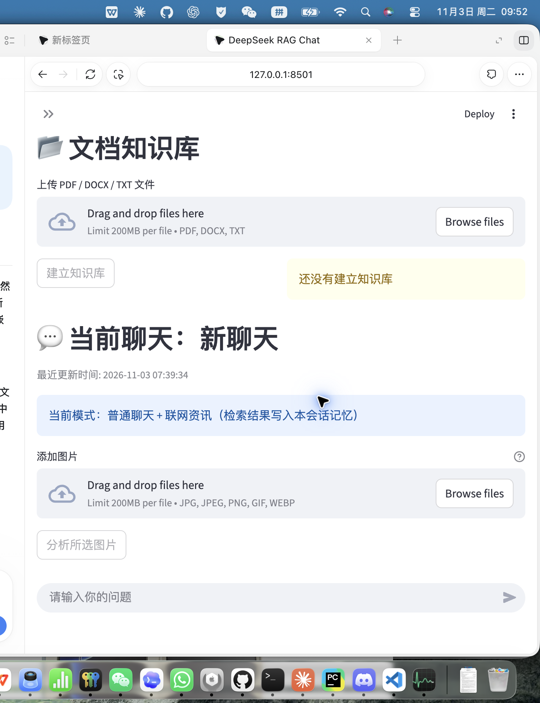
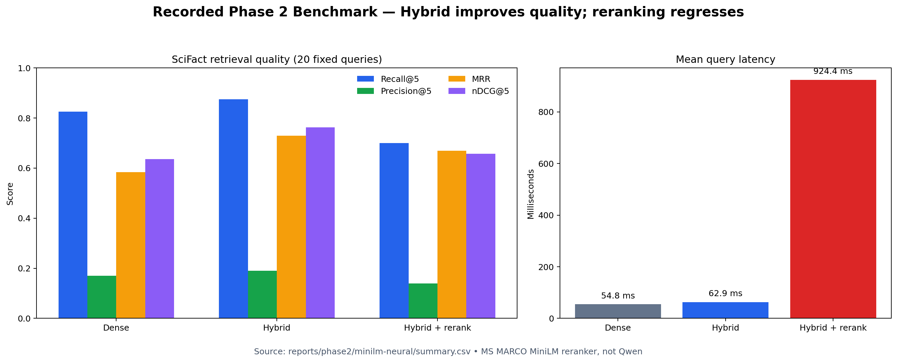
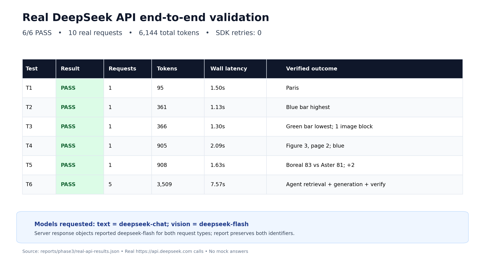

# DeepSeek Multimodal RAG & Research Agent

This repository is an incremental upgrade of the original DeepSeek Multi-Mode Chat project. It preserves the existing Streamlit application, multilingual chat, document Q&A, paper reading, CSV/Excel analysis, dashboards, and chat persistence while adding native vision, multimodal paper RAG, hybrid retrieval, model adapters, bounded agentic research, evaluation, and API usage auditing.

## Executive summary

The project was upgraded and validated in three phases:

- The new capabilities were integrated into the original application rather than implemented as a separate demo.
- Local regression and Streamlit integration tests passed for the major application paths.
- On the recorded SciFact benchmark, BM25 + FAISS + Reciprocal Rank Fusion produced the best overall retrieval quality.
- The MS MARCO MiniLM reranker reduced quality on the SciFact sample and increased latency substantially. This negative result is retained rather than hidden.
- Qwen Embedding and Qwen Reranker completed real local inference smoke tests. The full Qwen FP32 benchmark was stopped before completion, so no aggregate Qwen benchmark result is claimed.
- Six real DeepSeek API end-to-end tests passed using 10 paid requests, zero SDK retries, and 6,144 total tokens.

## Original project vs upgraded system

| Area | Original project | Upgraded system |
|---|---|---|
| General chat | DeepSeek text chat | Preserved, with model, token, latency, and call auditing |
| Image understanding | No complete native vision path | JPEG, PNG, GIF, and WebP uploads using standard `image_url` blocks and `deepseek-flash` |
| Multi-turn vision | No reliable image-history handling | Follow-up questions over previous images with request-level deduplication |
| PDF processing | Primarily text extraction and fixed chunking | Sections, headings, pages, tables, figures, captions, and visual metadata |
| PDF visual Q&A | Could not reliably answer from figures | Retrieves only relevant visual evidence and binds it to file, page, and citation metadata |
| Retrieval | FAISS dense retrieval | Original dense baseline, BM25 + FAISS + RRF, and optional neural reranking |
| Model support | Fixed lightweight embedding model | Adapter-based MiniLM and Qwen embedding/reranking with index compatibility checks |
| Agentic RAG | Basic routing, retrieval, rewriting, and verification | Cross-document comparison, decomposition, iterative retrieval, evidence tracking, and budgets |
| Evaluation | No reproducible retrieval benchmark | Recall@5, Precision@5, MRR, nDCG@5, latency, and memory reporting |
| Streamlit integration | Existing modes with some coupled state | Vision input, retrieval controls, Agent trace, evaluation view, and state-management fixes |

## Application UI

The screenshot below shows the running Streamlit application at `127.0.0.1:8501`, including document ingestion, general chat, and image upload.



## Implemented architecture

### Native DeepSeek Vision

- Accepts JPEG, PNG, GIF, and WebP files.
- Validates file size, dimensions, format, and local attachment paths.
- Converts images into OpenAI-compatible `image_url` content blocks.
- Uses `deepseek-flash` whenever a request contains visual content.
- Keeps image blocks only in user messages.
- Preserves follow-up context while preventing duplicate image blocks in the same request.
- Stores compact attachment metadata in chat history instead of persistent base64 payloads.

### Multimodal paper RAG

- Uses structure-aware PyMuPDF parsing with an optional Docling path and safe fallback.
- Preserves document name, page, section, figure/table label, caption, bounding box, and chunk ID.
- Retrieves visual evidence before rendering and sending it to the vision model.
- Does not send every PDF page to the API.
- Binds each visual to a verifiable source label such as `filename, p. 2, Figure 3`.
- Supports questions involving figures, tables, ablations, architectures, and cross-document results.

### Hybrid retrieval

The retrieval pipeline supports three modes:

1. Original FAISS dense retrieval.
2. BM25 + FAISS with Reciprocal Rank Fusion.
3. Hybrid retrieval with optional neural reranking.

Embedding and corpus fingerprints prevent incompatible FAISS indexes from being reused silently after a model or corpus change.

## Context packing

`pack_context` ranks retrieved chunks, respects a token budget, removes near-duplicates, and can cap chunks per source.
It preserves document, page, figure/table, score, and chunk metadata so citation numbering remains traceable.
Enable it with `retrieve_context(retriever, ..., enabled=True, max_tokens=4096)` and optionally set `max_per_source` or `similarity_threshold`.
The retrieval wrapper defaults to `enabled=False`, so existing Streamlit and evaluation behavior is unchanged.

### Extended Agentic RAG

The existing agent pipeline was extended rather than replaced. It now supports:

- query routing and optional decomposition;
- source-constrained cross-document retrieval;
- bounded iterative retrieval;
- evidence grading and sufficiency checks;
- optional web supplementation;
- visual evidence selection;
- grounded generation and final verification;
- explicit limits for iterations, tools, images, input size, output tokens, and API calls;
- inspectable evidence and execution traces.

## Recorded retrieval benchmark

The benchmark used the official BEIR SciFact corpus and relevance judgments: 5,183 abstracts and a fixed set of 20 official test queries. Every configuration used the same queries, corpus, and `all-MiniLM-L6-v2` dense vectors. K was 5, while MRR used the complete ranking.



| Configuration | Recall@5 | Precision@5 | MRR | nDCG@5 | Mean latency | Peak RSS |
|---|---:|---:|---:|---:|---:|---:|
| A: FAISS dense baseline | 0.8250 | 0.1700 | 0.5833 | 0.6359 | 54.79 ms | 697.0 MiB |
| B: BM25 + FAISS + RRF | **0.8750** | **0.1900** | **0.7290** | **0.7619** | 62.89 ms | 698.3 MiB |
| C: Hybrid + MS MARCO MiniLM reranker | 0.7000 | 0.1400 | 0.6686 | 0.6565 | 924.41 ms | 811.9 MiB |

### Interpretation

- Hybrid retrieval increased Recall@5 from 0.825 to 0.875, MRR from 0.5833 to 0.7290, and nDCG@5 from 0.6359 to 0.7619.
- Mean latency increased only from 54.79 ms to 62.89 ms, making hybrid retrieval the recommended default in the tested environment.
- Configuration C used `cross-encoder/ms-marco-MiniLM-L-6-v2`, not Qwen.
- On this SciFact sample, reranking reduced Recall@5 to 0.700 and increased mean latency to 924.41 ms.
- No benchmark was run on the MS MARCO dataset. The model was trained on MS MARCO but evaluated here only on SciFact.
- This fixed 20-query measurement is a local comparison, not an official full SciFact leaderboard result.

Machine-readable results are available in:

- `reports/phase2/minilm-neural/summary.csv`
- `reports/phase2/minilm-neural/retrieval.json`
- `reports/phase2/minilm-neural/queries.csv`

## Qwen local-model validation

### Qwen Embedding

- Loaded `Qwen/Qwen3-Embedding-0.6B` as `Qwen3Model` with 595,776,512 parameters.
- A real BF16 CPU smoke test produced document embeddings of shape `[2, 1024]` and a query embedding of shape `[1, 1024]`.
- The relevant and irrelevant document scores were approximately 0.7353 and 0.1765.
- The final CPU path was later changed to FP32, but the complete benchmark was not rerun. MiniLM results are not presented as Qwen results.

### Qwen Reranker

- Loaded `Qwen/Qwen3-Reranker-0.6B` as `Qwen3ForCausalLM` with 595,776,512 parameters.
- A real FP32 CPU forward pass scored the relevant and irrelevant candidates at approximately 0.99745 and 0.00001537.
- The full Qwen FP32 benchmark was stopped before completion.
- Its explicit incomplete status is stored in `reports/phase2/qwen-neural/incomplete.json`.

## Real DeepSeek API validation

These tests used the actual project modules and real requests to `https://api.deepseek.com`. They did not use mock responses. SDK retries were disabled and the script enforced a hard limit of 12 requests; 10 requests were actually made.



| Test | Result | Requests | Tokens | End-to-end latency | Verified outcome |
|---|---:|---:|---:|---:|---|
| T1: Text chat | PASS | 1 | 95 | 1.50 s | Correctly answered that Paris is the capital of France |
| T2: Image understanding | PASS | 1 | 361 | 1.13 s | Correctly identified the blue bar as the tallest |
| T3: Multi-turn vision | PASS | 1 | 366 | 1.30 s | Correctly identified the green bar as the shortest; one image block |
| T4: Multimodal PDF RAG | PASS | 1 | 905 | 2.09 s | Located Figure 3 on page 2 and answered blue |
| T5: Cross-document Q&A | PASS | 1 | 908 | 1.63 s | Compared Boreal 83 with Aster 81 and calculated a 2 AP difference |
| T6: Agentic RAG | PASS | 5 | 3,509 | 7.57 s | Completed retrieval, evidence filtering, generation, and verification |

Total usage was 4,961 prompt tokens and 1,183 completion tokens, for 6,144 tokens overall. No cost estimate is reported because no reliable price table was configured.

### Vision test image

The image below was genuinely sent to DeepSeek Vision. The prompt did not disclose the color ordering or expected answer.


### PDF and Agent findings

- The PDF test used the real upload, PyMuPDF parsing, MiniLM/FAISS indexing, BM25 + FAISS + RRF retrieval, visual selection, and RAG generation chain.
- Figure 3 was retrieved as `synthetic-aster.pdf, p. 2, Figure 3` and only one relevant visual was sent.
- The follow-up vision request contained one historical image block. Prompt usage increased only from 308 to 326 tokens.
- Agentic RAG used five real API calls and retrieved evidence from both `synthetic-aster.pdf` and `synthetic-boreal.pdf`.
- The Agent correctly reported 83, 81, and a difference of 2, and stated that night-time scenes and CPU inference latency were not measured.
- Text requests specified `deepseek-chat`, while vision requests specified `deepseek-flash`. The response objects reported `deepseek-flash` for both request types, so the audit preserves both requested and returned identifiers without inferring internal server routing.

Detailed evidence is available in:

- `docs/REAL_API_VALIDATION.md`
- `reports/phase3/real-api-results.json`

## Regression and integration testing

- Original suite: 34 passed and one paid test skipped out of 35.
- Six targeted regressions: all six failed before the fixes and passed afterward.
- Intermediate full suite: 40 passed and one paid test skipped out of 41.
- Later targeted regression and evaluation checks: 13 passed.
- Streamlit application integration: four tests passed, covering images, PDFs, data analysis, persistence, retrieval strategy switching, and four UI languages.
- The final lightweight static check passed.

Mock-based integration tests and real paid DeepSeek tests are explicitly separated throughout the evidence. Mock results are never presented as real API results.

## Major fixes and optimizations

1. Fixed adjacent Chinese-language figure/table references, including single-figure and multi-table forms.
2. Prevented explicitly requested figures from being padded with unrelated logos or images.
3. Preserved multiple citations when identical same-page crops are deduplicated.
4. Added document, page, figure/table, and evidence-ID bindings before every PDF image block.
5. Deduplicated historical images within each API request.
6. Reused compatible PDF parses, indexes, and summaries to avoid repeated computation and API calls.
7. Added embedding and corpus fingerprints to prevent incompatible FAISS index reuse.
8. Reused query embeddings inside a single Agent execution.
9. Clamped reranker input lengths to model-supported limits.
10. Limited Qwen reranker logits to the final token to reduce memory and computation.
11. Corrected MRR so it is not truncated at K.
12. Cleared stale dictionaries, reports, and model state when CSV/XLSX input changes.
13. Fixed duplicate Streamlit Plotly component IDs.
14. Added requested model, returned model, prompt/completion/total tokens, and latency to API audit records.

## Known limitations

- The complete Qwen FP32 benchmark remains unfinished, so no aggregate Qwen SciFact metrics are reported.
- Docling/OCR was not validated in the current environment; the application safely falls back to PyMuPDF.
- The SciFact benchmark uses a fixed 20-query local sample and is not an official full benchmark submission.
- The negative MiniLM reranking result applies only to the recorded SciFact conditions and should not be generalized to every domain.
- The application remains a local single-user Streamlit/JSON system rather than a multi-user production service.
- API cost is not estimated without a reliable configured price table.

## Plain RAG vs Agentic RAG evaluation

The `eval/` package compares the existing Plain RAG and Agentic RAG pipelines under the same documents, embedding model, hybrid retrieval strategy, initial Top-K, generation model, and questions. It records retrieval evidence, answers, Agent traces, latency, API calls, prompt/completion tokens, and separate real DeepSeek LLM-as-Judge results.

The included 32-question draft and eight-question pilot are based on synthetic validation PDFs. Every item is marked `needs_human_review=true`; these results are a **Real DeepSeek API Pilot Evaluation — Synthetic Dataset**, not a formal benchmark or a performance claim for a research dataset.

Metrics include Retrieval Hit@K, graded answer correctness, faithfulness, abstention accuracy, unsupported-claim rate, mean/median/P95 latency, API calls, tokens, and optional cost. The Judge uses a fixed JSON rubric and temperature zero. Because generator and Judge may use related models, the scores may contain self-preference bias and require human review.

Dry run without API calls:

```bash
.venv/bin/python -m eval.run --mode both --dataset eval/dataset.jsonl --k 4 --seed 42 --dry-run
```

Real evaluation:

```bash
.venv/bin/python -m eval.run --mode both --dataset eval/dataset.jsonl --k 4 --seed 42 --max-api-calls 80
```

Model prices can be added to `eval/config.yaml` under `prices_per_million_tokens`. When no reliable price is configured, the runner reports real token usage and marks cost as unavailable. The recorded pilot artifacts are under `eval/results/real-pilot-20261103/`.

## Recommended configuration

For the tested macOS CPU environment:

- Embedding: `all-MiniLM-L6-v2`
- Retrieval: BM25 + FAISS + RRF hybrid retrieval
- Reranking: disabled by default until validated on the target domain
- Text model: the configured DeepSeek text model
- Vision model: `deepseek-flash`
- Agent: enable when needed and retain strict iteration, tool, image, and API-call limits

## Installation and launch

### Existing environment

```bash
cd /Users/ingchaolee/PycharmProjects/PythonProject_ai
.venv/bin/python -m streamlit run app.py
```

### New Python 3.12 environment

```bash
cd /Users/ingchaolee/PycharmProjects/PythonProject_ai
python3.12 -m venv .venv312
source .venv312/bin/activate
python -m pip install --upgrade pip
python -m pip install -r requirements.txt
python -m streamlit run app.py
```

Configure the API key through the environment or Streamlit secrets. Never place credentials in source code or committed files.

Environment variable:

```bash
export DEEPSEEK_API_KEY="your-key-here"
```

Streamlit secrets:

```toml
DEEPSEEK_API_KEY = "your-key-here"
DEEPSEEK_TEXT_MODEL = "deepseek-chat"
DEEPSEEK_VISION_MODEL = "deepseek-flash"
```

## Evidence index

| Evidence | Location |
|---|---|
| Main English report | `README.md` |
| Detailed real API report | `docs/REAL_API_VALIDATION.md` |
| Retrieval benchmark screenshot | `docs/images/retrieval-benchmark.png` |
| Real API validation screenshot | `docs/images/real-api-validation.png` |
| Streamlit UI screenshot | `docs/images/streamlit-app.png` |
| Vision test image | `docs/images/vision-test-bars.png` |
| Retrieval raw results | `reports/phase2/minilm-neural/` |
| Qwen incomplete status | `reports/phase2/qwen-neural/incomplete.json` |
| Real API raw results | `reports/phase3/real-api-results.json` |
