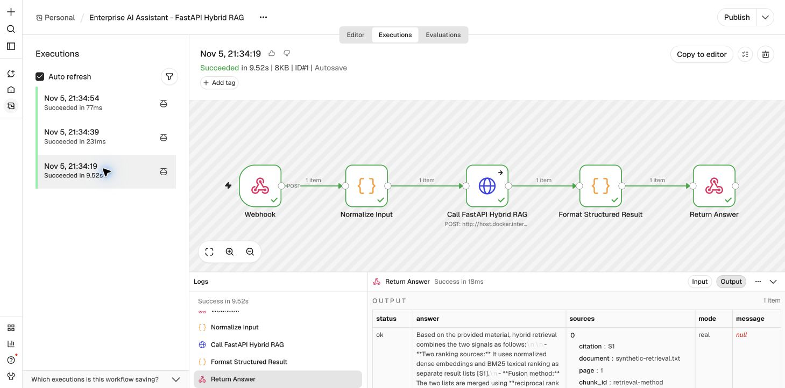

# Enterprise AI Assistant local validation

Date: 2026-11-05 (Europe/Berlin)

## Verified environment

- Repository initially had no FastAPI application, API route, Docker Compose file, or n8n workflow.
- Local n8n container: `n8n`, image `docker.n8n.io/n8nio/n8n`, version **2.46.6**, published as `127.0.0.1:5678`.
- `GET /healthz` and `GET /healthz/readiness` returned HTTP 200.
- `GET /rest/settings` returned HTTP 200; `/api/v1/workflows` and `/rest/workflows` returned HTTP 401 without credentials.
- The workflow was imported through the logged-in n8n web UI and left unpublished. No public Webhook was enabled.
- FastAPI was not running on port 8000 before this implementation.

## Execution modes

Validation used `ENTERPRISE_ASSISTANT_MODE=mock`. Retrieval was real local inference through the existing `all-MiniLM-L6-v2`, FAISS, BM25 and Reciprocal Rank Fusion implementation over `evaluation/example.json`. Answer generation was deterministic and explicitly labelled `[MOCK GENERATION — RETRIEVED EVIDENCE]`. No DeepSeek or other paid LLM request was made.

A separate browser-driven smoke test used `ENTERPRISE_ASSISTANT_MODE=real` and the existing securely configured `DEEPSEEK_API_KEY`. It executed the imported workflow with n8n's **Test workflow** mode. The successful request used the configured `deepseek-chat` model through `https://api.deepseek.com`; no key was printed, saved to the workflow, or committed.

## Results

| Scenario | Execution | Result | Evidence |
|---|---|---|---|
| Normal query | Real FastAPI process and real local hybrid retrieval | PASS | HTTP 200, `status=ok`, `mode=mock`, structured sources returned. |
| Empty input | Real FastAPI process | PASS | HTTP 400, `status=invalid_request`, empty sources. |
| No related material | Real FastAPI process | PASS | HTTP 200, `status=no_evidence`, fixed insufficiency answer, empty sources. |
| Service unavailable | Request from the running n8n Docker container after FastAPI stopped | PASS | `host.docker.internal:8000` returned `ECONNREFUSED`, as expected. The imported workflow formatted it as `status=service_unavailable`. |
| Request timeout | Real FastAPI process with 50 ms request limit and controlled mock delay | PASS | HTTP 504, `status=timeout`, response in approximately 0.057 seconds. |
| Docker host routing | Node.js `fetch` from the n8n container to Mac FastAPI | PASS | HTTP 200 from `http://host.docker.internal:8000/api/ask` with answer and sources. |
| Workflow import syntax | Ephemeral n8n 2.46.6 container with an isolated temporary database | PASS | `Successfully imported 1 workflow.` The container was removed afterward and the user's n8n database was untouched. |

## Real n8n + DeepSeek smoke test

The following three executions were run on 2026-11-05 through the user's local n8n 2.46.6 UI after importing `n8n/enterprise_ai_assistant.workflow.json`. The workflow remained unpublished.

| Scenario | Result | n8n duration | HTTP observation |
|---|---|---:|---|
| Real DeepSeek answer | PASS | 9.52 s | `status=ok`, `mode=real`, answer contained `[S1]`, and five structured sources were returned. Client-observed round trip: 9.563 s. |
| Empty input `{}` | PASS | 231 ms | `status=invalid_request`, empty answer and sources, message `question must not be empty`. Client-observed round trip: 0.305 s. |
| FastAPI stopped | PASS | 77 ms | `status=service_unavailable`, empty answer and sources, with the expected Docker-host `ECONNREFUSED`. Client-observed round trip: 0.101 s. |

The successful query was `How does hybrid retrieval combine BM25 and dense retrieval?`. DeepSeek correctly described separate BM25 and dense rankings combined with Reciprocal Rank Fusion, cited `[S1]`, and explicitly avoided claiming unavailable implementation details. Source `S1` mapped to `synthetic-retrieval.txt`, page 1, chunk `retrieval-method`.

The request-level audit record reports one real API call, 640 prompt tokens, 161 completion tokens, 801 total tokens, and 2,268.05 ms model-call latency. End-to-end latency was higher because the first request also initialized the local embedding/retrieval stack. Cost is recorded as **N/A** because no trusted price entry was configured. The request model was `deepseek-chat`; the server-returned model identifier was not persisted by the external FastAPI response and is therefore not claimed here.

The error-path canvas and structured `service_unavailable` output are captured separately in `docs/images/n8n-enterprise-workflow-result.jpg`.

Targeted offline pytest result: **6 passed**. Tests inject fake backends and make no network or paid API calls. They cover the five required scenarios plus workflow JSON compatibility checks.

Full repository pytest result after implementation: **74 passed, 1 skipped**. The skipped test is the explicitly opted-in paid API integration test. FastAPI was stopped after validation; no demo server was left running.

## n8n workflow compatibility

`n8n/enterprise_ai_assistant.workflow.json` uses node versions observed in the installed n8n 2.46.6 container:

- Webhook `2.2`
- Code `2`
- HTTP Request `4.5`
- Respond to Webhook `1.5`

The workflow is saved with `active=false`. It accepts `{ "question": "..." }`, calls the Mac host through `host.docker.internal`, formats success and error payloads, and returns structured JSON. Import parsing was first validated in an ephemeral isolated n8n container, then the file was imported through the user's logged-in n8n UI and executed three times in Test workflow mode. It was not published or activated.

## Known limitations

- Mock generation returns retrieved excerpts rather than a synthesized answer; it is intended only for offline integration validation.
- The lightweight no-evidence gate uses lexical overlap before hybrid retrieval and may reject synonym-only questions.
- `asyncio.wait_for` returns a timeout response but cannot forcibly terminate an already-running synchronous model or API thread.
- The FastAPI demo has no authentication, rate limiting, tenant separation, durable job queue, or production observability.
- This was one paid real-generation smoke request over a small synthetic corpus, not a quality benchmark or production load test.
- n8n reports workflow-level success for handled error responses; consumers must inspect the structured `status` field.
