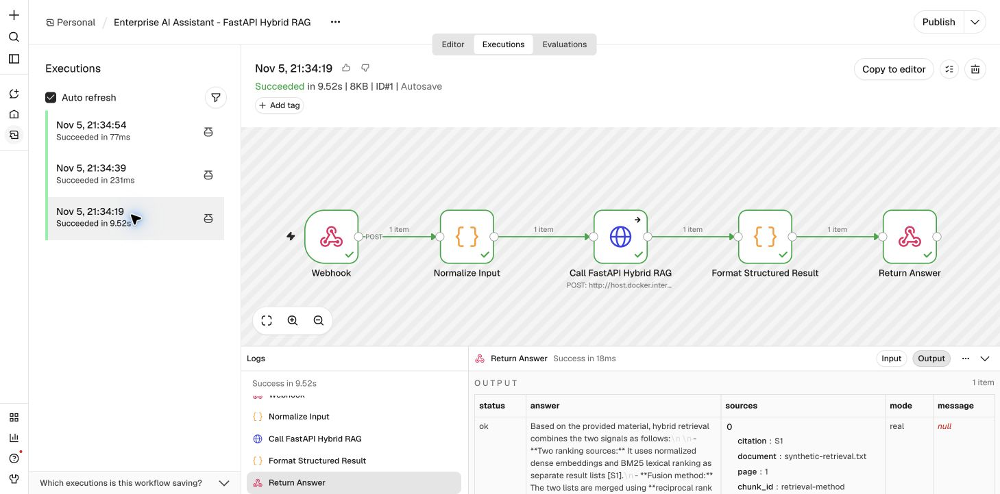

# n8n Processing Guide

This guide explains how to run the local Enterprise AI Assistant workflow that connects n8n, FastAPI, the existing Hybrid RAG system, and DeepSeek.

## Architecture

```text
Client JSON request
        |
        v
n8n Webhook
        |
        v
Normalize Input
        |
        v
HTTP Request: FastAPI POST /api/ask
        |
        v
Hybrid RAG: BM25 + FAISS + RRF
        |
        v
DeepSeek answer generation
        |
        v
Structured n8n response with sources
```

The workflow returns four main fields:

- `status`: `ok`, `invalid_request`, `no_evidence`, `timeout`, or `service_unavailable`.
- `answer`: the generated answer, or an empty string for handled errors.
- `sources`: retrieved document, page, figure/table, chunk ID, and score metadata.
- `mode`: `mock`, `real`, or `unknown` when FastAPI cannot be reached.

## Prerequisites

- The repository virtual environment is available at `.venv`.
- Docker Desktop is running.
- The local n8n container is running at `http://localhost:5678`.
- `DEEPSEEK_API_KEY` is configured as an environment variable or Streamlit secret for real generation.
- The API key must never be placed in the workflow JSON or committed to Git.

Check n8n:

```bash
docker ps --filter name=n8n
curl http://127.0.0.1:5678/healthz
```

## Start FastAPI

From the repository root:

```bash
cd /Users/ingchaolee/PycharmProjects/PythonProject_ai
```

### Real DeepSeek mode

```bash
export ENTERPRISE_ASSISTANT_MODE=real
.venv/bin/python -m uvicorn src.enterprise_api:app \
  --host 0.0.0.0 \
  --port 8000
```

The service reads `DEEPSEEK_API_KEY` from the existing secure configuration. Do not print the key while checking the environment.

### Offline mock mode

```bash
export ENTERPRISE_ASSISTANT_MODE=mock
.venv/bin/python -m uvicorn src.enterprise_api:app \
  --host 0.0.0.0 \
  --port 8000
```

Mock mode performs real local hybrid retrieval but does not call a paid LLM. Mock answers are explicitly marked as mock generation.

Verify FastAPI:

```bash
curl http://127.0.0.1:8000/healthz
```

## Import the n8n workflow

1. Open `http://localhost:5678` and sign in to the local n8n instance.
2. Create or open an empty workflow.
3. Select **More actions → Import → From file**.
4. Choose:

   ```text
   n8n/enterprise_ai_assistant.workflow.json
   ```

5. Confirm that the following five nodes appear:

   ```text
   Webhook
     → Normalize Input
     → Call FastAPI Hybrid RAG
     → Format Structured Result
     → Return Answer
   ```

6. Keep the workflow unpublished while testing.

The HTTP Request node deliberately uses:

```text
http://host.docker.internal:8000/api/ask
```

When n8n runs in Docker, `localhost:8000` points to the n8n container rather than the macOS host.

## Run Test workflow

Click **Test workflow** before each request. n8n then waits for one request on:

```text
http://127.0.0.1:5678/webhook-test/enterprise-ai-assistant
```

### Successful RAG request

```bash
curl -X POST \
  http://127.0.0.1:5678/webhook-test/enterprise-ai-assistant \
  -H 'Content-Type: application/json' \
  -d '{"question":"How does hybrid retrieval combine BM25 and dense retrieval?"}'
```

Expected behavior:

- `status` is `ok`.
- `mode` is `real` when real DeepSeek mode is enabled.
- The answer contains a citation such as `[S1]`.
- `sources` contains traceable document and chunk metadata.

### Empty input

Click **Test workflow** again, then run:

```bash
curl -X POST \
  http://127.0.0.1:5678/webhook-test/enterprise-ai-assistant \
  -H 'Content-Type: application/json' \
  -d '{}'
```

Expected response:

```json
{
  "status": "invalid_request",
  "answer": "",
  "sources": [],
  "message": "question must not be empty"
}
```

### FastAPI unavailable

Stop FastAPI with `Ctrl+C`, click **Test workflow** again, and repeat the successful request.

Expected behavior:

- `status` is `service_unavailable`.
- `answer` is empty.
- `sources` is empty.
- The message reports a connection failure to `host.docker.internal:8000`.

n8n may label the overall execution as successful because the workflow intentionally converts the connection error into structured JSON. Always inspect the returned `status` field.

## Verified local results

The following tests were executed on local n8n 2.46.6 using the imported workflow:

| Scenario | Result | n8n duration |
|---|---|---:|
| Real DeepSeek generation | `status=ok`, cited answer and five sources | 9.52 s |
| Empty input | `status=invalid_request` | 231 ms |
| FastAPI stopped | `status=service_unavailable` | 77 ms |

The real request used the configured `deepseek-chat` model and made one paid API call:

- Prompt tokens: 640
- Completion tokens: 161
- Total tokens: 801
- Model-call latency recorded by the audit log: 2,268.05 ms
- End-to-end client latency: 9.563 s
- Estimated cost: N/A because no trusted model price was configured

These results are a synthetic-corpus integration smoke test, not a production benchmark.



## Direct FastAPI request

The n8n layer can be bypassed when diagnosing the backend:

```bash
curl -X POST http://127.0.0.1:8000/api/ask \
  -H 'Content-Type: application/json' \
  -d '{"question":"How does hybrid retrieval combine BM25 and dense retrieval?"}'
```

If the direct request works but n8n fails, check Docker host routing and the HTTP Request node. If both fail, check FastAPI logs and the configured corpus or model.

## Tests

Run the focused offline test suite:

```bash
.venv/bin/python -m pytest -q tests/test_enterprise_api.py
```

The tests use injected fake backends and do not consume paid API tokens.

## Troubleshooting

### `ECONNREFUSED host.docker.internal:8000`

- Confirm FastAPI is running.
- Confirm it listens on `0.0.0.0`, not only an inaccessible container address.
- Run `curl http://127.0.0.1:8000/healthz` on the Mac.

### Missing API key

Configure `DEEPSEEK_API_KEY` through the environment or Streamlit secrets. Never add it to the workflow, source code, README, screenshots, or Git history.

### Request timeout

Increase `RAG_REQUEST_TIMEOUT_SECONDS` for slow first-time CPU model loading. The first request can include embedding-model and retrieval-index initialization.

### No evidence

`status=no_evidence` means the configured corpus did not provide sufficient matching evidence. The service returns an abstention instead of asking the LLM to guess.

### Production use

This local demo does not provide authentication, tenant isolation, rate limiting, a durable job queue, or production observability. Do not expose the Webhook or FastAPI port publicly without adding those controls.

## Additional evidence

See `docs/ENTERPRISE_VALIDATION.md` for detailed mock, Docker-network, timeout, real DeepSeek, token-usage, and error-path validation records.
